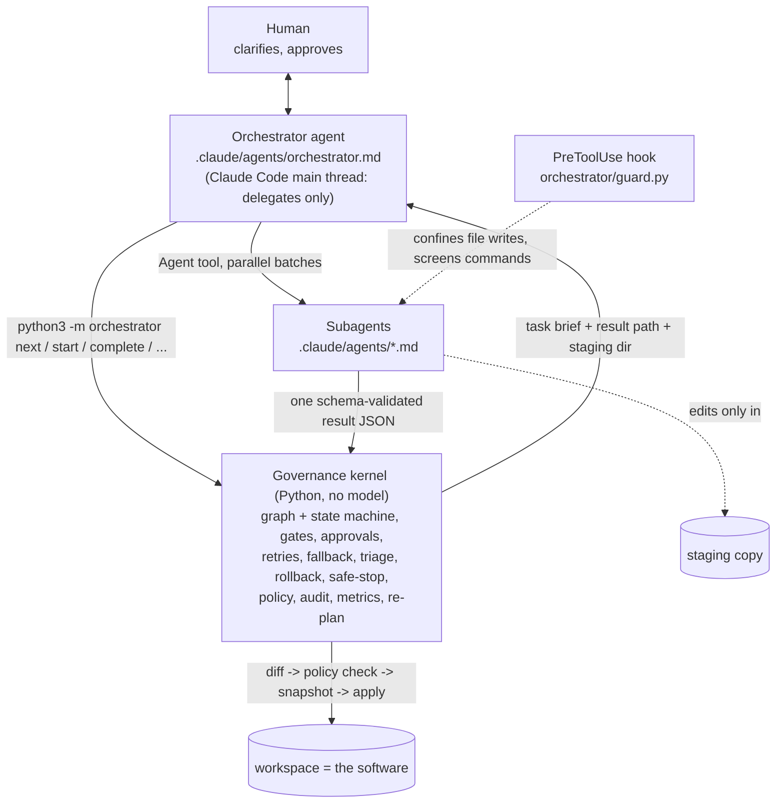
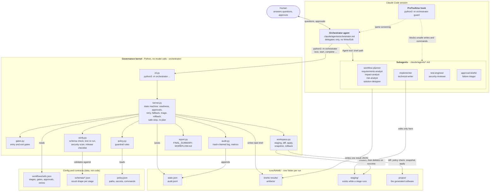
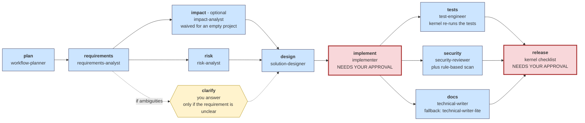
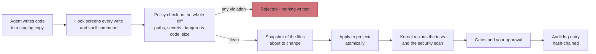
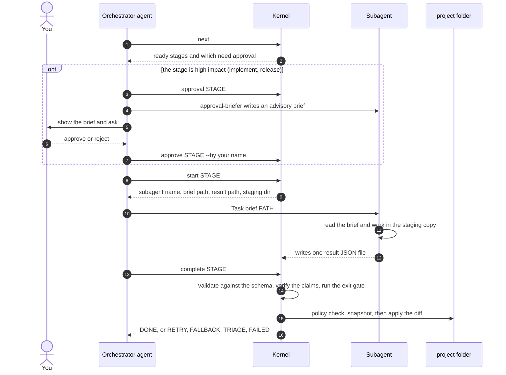
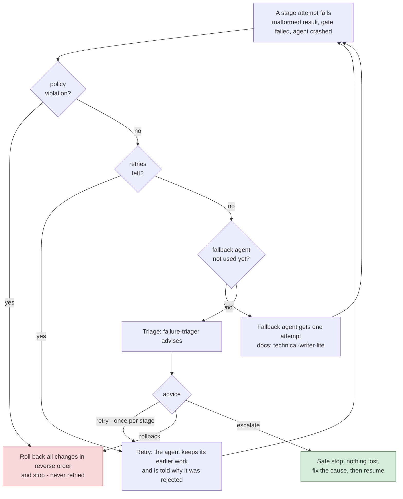

# Agentic AI system that implements or modifies a codebase from a requirement document

You write a requirement in a text file. A team of AI agents (Claude Code subagents) turns it into working software: they plan, analyse risk,
design, write the code and tests, review security, write the docs and prepare a release decision. It can build a **new project** or **change an
existing codebase**, and the requirement may be precise or vague.

The agents do the thinking and the typing. They are **not trusted to police themselves**. A small deterministic program (the *kernel*, plain Python,
no AI) decides which step may run next, checks every result, applies code only after a policy check, re-runs the tests itself, asks you to approve the
risky steps, and keeps a tamper-evident record of everything.

> *Agents execute under defined autonomy boundaries; humans own oversight, approvals and final quality.*

| Piece | What it is |
|---|---|
| **Subagents** | Markdown files in `.claude/agents/`: one per job (requirements, design, implement, test, ...). The AI work. |
| **Orchestrator agent** | `.claude/agents/orchestrator.md`, started with `/orchestrate`. Calls the kernel and hands each stage to the right subagent. It has no Write/Edit tools. |
| **Kernel** | Python in `orchestrator/` behind `python3 -m orchestrator ...`. Makes **no model calls**. Enforces the rules below. |
| **Workflow** | `workflows/sdlc.json`: the stages, their order, gates, approvals, retries and fallbacks, as data. |

Nothing is hard-coded to a technology. The stack comes from your requirement text (or from the existing code); the design agent records the build/test/run commands.

## Detailed architecture

### Overview



- **Agents decide what to build and how** (subagent files = role, tools, model, instructions).
- **The kernel decides whether it may happen** and keeps the evidence. It is a plain state machine persisted in
  `runs/<name>/state.json`; each CLI call performs one transition and prints JSON. It contains no model calls and
  launches no processes other than the project's own test/setup commands.
- **The orchestrator agent is the glue**: it calls the kernel, delegates, and relays questions to the human. Its tools are
  `Agent, Bash, Read, AskUserQuestion` - no Write/Edit, so it cannot change the project or the evidence itself. Even if it
  misbehaves, the kernel refuses transitions that skip a control (start before approval, before dependencies, with a bad result...).

### Component view



Reading it: the **orchestrator agent** is the only thing that talks to both sides. It asks the **kernel** what is allowed, hands each stage to a **subagent**, and relays your answers.
Subagents never touch the real project: they edit a staging copy and write one result file, and the kernel decides whether and how it reaches `project/`.
The **hook** sits beside every agent tool call. The workflow, schemas and policy are data files, so the process can be changed without touching code.

## Prerequisites

| Need | Why |
|---|---|
| **Claude Code** (desktop app or CLI), logged in | Runs the orchestrator and the subagents. Open it **in this folder**, in a **new session**, so `.claude/agents`, the command and the hook are loaded. |
| **Python 3.10+**, `git`, `sh` | The kernel and its tests (the kernel itself uses only the standard library; `pytest` is the only package). |
| **The toolchain your requirement needs** | The kernel and agents run the project's own setup/test commands. Example: for `examples/inputs/url-shortener-short.md` (Java + Spring Boot + Maven) you need a JDK (17+) and Maven 3.9, plus internet for the first dependency download. |
| Toolchain on **Claude Code's PATH** | The desktop app does not read `~/.zshrc`. Put tools in a folder that app processes see, or in `~/.zshenv`. Check with `mvn -v` (or your tool) in a fresh shell. |
| macOS only: Xcode license accepted | `make`, `git` and `brew` are Apple/Homebrew shims that refuse to run until you run `sudo xcodebuild -license accept`. Without it use the plain commands shown below instead of `make`. |

## Commands to start

**One-time setup and self-test (terminal, in this folder)**
```bash
make setup
```
```bash
make test
```
Without `make`: `python3 -m venv .venv && .venv/bin/python -m pip install -r requirements.txt`, then `.venv/bin/python -m pytest -q` (62 tests, no AI, ~10 s).

**Run the system (inside Claude Code, not the terminal)**
```
/orchestrate examples/inputs/url-shortener-short.md
```
```
/orchestrate examples/inputs/url-shortener.md --config examples/inputs/url-shortener.config.json --scripted
```
| Option | Meaning |
|---|---|
| `<requirement-file>` | Any requirement document (markdown/text). The run is named after the file. |
| `--project DIR` | Folder to build in or change. Default `runs/<name>/project`. Point it at an existing repo to modify that code. |
| `--config FILE` | Optional run config: `title`, `release_version`, `reviewer` (simulated approver for `--scripted`), `faults`, `amendment`. |
| `--scripted` | Use the config's simulated reviewer. Without it, the orchestrator **asks you** for clarifications and the two approvals. |
| `--inject STAGE:N` | Fault drill: that stage fails its next N attempts before any agent is used (costs nothing). |
| `--resume` | Continue a halted run of the same requirement. |

**Inspect and control (terminal)**
```bash
python3 -m orchestrator --run runs/url-shortener-short status
```
```bash
python3 -m orchestrator --run runs/url-shortener-short metrics
```
```bash
python3 -m orchestrator verify-audit runs/url-shortener-short/audit.jsonl
```
Emergency stop (the run halts safely after the current stage finishes, nothing is rolled back): `touch runs/STOP`.
The other kernel commands (`init`, `next`, `start`, `complete`, `fail`, `approval`, `record-brief`, `approve`, `triage`, `amend`, `stop`, `guard`) are used by the orchestrator agent and the hook, not by you.

## Stages in the agent flow



Blue = agent stage, yellow = a human stage, red outline = needs your recorded approval. `impact`, `risk` and `clarify` run in parallel; `tests`, `security` and `docs` run in parallel;
`design` and `release` wait for everything before them (a join). `release` is computed by the kernel, not by an agent.

Each stage is one subagent, then the kernel checks its result. A stage starts only when everything it depends on is finished.

| # | Stage | Agent | What happens | Kernel check before it counts as done |
|---|---|---|---|---|
| 1 | `plan` | workflow-planner | Looks at the requirement and the project; may waive the optional `impact` stage, adds guidance, lists risks to watch | Only optional stages can be waived; anything else is rejected and logged |
| 2 | `requirements` | requirements-analyst | Numbered statements, genuine ambiguities each with a default assumption, task list, kind of work (`new-build`, `change-existing`, `bug-fix`, `refactor`, `tests-or-docs`) | Result matches the schema; if there are ambiguities, a `clarify` stage is added to the graph at runtime |
| 3 | `clarify` | **you** (a human stage) | Answer the questions, or accept the defaults (recorded as assumptions) | Entry gate: design cannot start while ambiguities are unresolved |
| 4 | `impact` | impact-analyst | Existing code only: files to change, ripple effects, affected flows | Skipped (waived) for an empty project |
| 5 | `risk` | risk-analyst | Risk register: each risk gets a mitigation and a validation | Schema |
| 6 | `design` | solution-designer | Chooses the stack from the requirement (or reuses the existing one); defines test/run commands, interfaces, schema changes, decisions, trade-offs, rollback plan | Exit gate: has an interface, a test command, and a validation for **every** risk; agent-written commands are screened by policy |
| 7 | `implement` | implementer | Writes code and tests in an isolated **staging copy**, runs the project's tests, fixes failures (at most 5 rounds) | **Needs your approval.** Diff is policy-checked, then applied atomically with a rollback snapshot; gate: at least one file written |
| 8 | `tests` | test-engineer | Runs the full suite and reports counts | **The kernel re-runs the tests itself**; its exit code is what counts |
| 9 | `security` | security-reviewer | Reviews the code for real vulnerabilities | Merged with a rule-based scan of the changed files; any **high** finding blocks |
| 10 | `docs` | technical-writer (fallback: technical-writer-lite) | README, API reference, operations notes, written into the project | Same staging + policy-checked apply; the fallback agent runs if the writer fails |
| 11 | `release` | the kernel itself (not an agent) | Computes go/no-go from evidence | **Needs your approval**; checklist: tests green, no high findings, docs exist, every risk validated, audit chain intact, approvals recorded, change size within policy |

Before each approval an **approval-briefer** subagent writes a plain-language brief (advisory only, it never approves). After a stage has failed for good, a **failure-triager** advises retry / rollback / escalate.

**When something fails:** retry (once) -> fallback agent (docs) -> triage advice -> **rollback** of the changes (exact restore) or a **safe stop** you can resume. A later change (`amend`) re-runs only the stages whose inputs changed.

## Guardrails

Seven layers, from "what an agent may touch" to "what is proven afterwards":

1. **Least privilege per agent.** Each subagent file lists only the tools it needs: analysts can read and write their one result file; only the implementer and test-engineer get a shell; the orchestrator can delegate and run the kernel but has no Write/Edit; subagents cannot spawn other agents.
2. **Hook guard** (`.claude/settings.json` -> `orchestrator/guard.py`), active while a run is active. File-writing tools may only write under the run's `results/` and `staging/`; web tools are denied; shell commands are screened (no `sudo`, `curl`, `wget`, `ssh`, `rm -rf` on system paths, `../`, `~/`, absolute system paths such as `/etc`; the run's own folders are allowed), and may not touch the kernel's state, policy, workflow, schemas or agent files; subagents may not run `approve`, `stop`, `amend` or `triage`.
3. **Staging, then policy check, then apply** (`policy.json`). Agents edit a **copy**. Their diff is checked as a whole before anything reaches the project: protected paths (`.git/`, `.claude/`, `.github/`, `.env*`, keys and certificates), size limits (120 files, 400 KB each), hard-coded secrets and private keys, dynamic code evaluation, shell execution, unsafe deserialization, disabled TLS verification, SQL built from strings. **One violation rejects the whole change and nothing is written; it is never retried.** Accepted changes are snapshotted first so they can be undone exactly.
4. **Claims are verified, not trusted.** Agent results must match a schema. The kernel re-runs the tests (an agent saying "green" does not count), merges its own security scan, and computes release readiness from evidence.
5. **Human approvals.** `implement` and `release` cannot start without a recorded approval **for the current inputs**; if the design changes afterwards, the approval no longer counts. No approver means no approval. A rejection halts the run safely.
6. **Bounded autonomy over time.** Retries are limited; triage allows one supervised retry per stage; the planner can only waive optional stages; graph changes are cycle-checked; `touch runs/STOP` halts safely; costs are bounded by the small retry budget.
7. **Audit and evidence.** Every event goes into a hash-chained `audit.jsonl` (editing or deleting a record is detectable with `verify-audit`); decisions are recorded with who made them and from which input versions; metrics (success rate, retries, rollbacks, recovery time, latency) are computed only from that log.

**Honest limits:** this is not an OS sandbox (an agent with a shell could still do things a text screen does not recognise: use a container for untrusted requirements); the kernel records who the orchestrator says approved but cannot prove it was a human; agent output varies between runs. See [`docs/FINDINGS.md`](docs/FINDINGS.md).

## How a code change reaches your project



## Repository structure and what each agent does

```
urlShortner/
├── .claude/
│   ├── agents/                      <- THE AGENTS (Claude Code subagent files: role, tools, model)
│   │   ├── orchestrator.md          main orchestrator: drives the kernel, delegates, relays your answers (no Write/Edit)
│   │   ├── workflow-planner.md      stage "plan": waives optional stages, adds guidance, lists risks to watch
│   │   ├── requirements-analyst.md  stage "requirements": numbered statements, ambiguities + defaults, task list
│   │   ├── impact-analyst.md        stage "impact" (optional): impacted files/flows in existing code
│   │   ├── risk-analyst.md          stage "risk": risk register, each with a mitigation and a validation
│   │   ├── solution-designer.md     stage "design": stack choice, build/test/run commands, API, ADRs, rollback plan
│   │   ├── implementer.md           stage "implement": writes code + tests in a staging copy, runs its own test/fix loop
│   │   ├── test-engineer.md         stage "tests": runs the suite and reports counts (the kernel re-runs it to verify)
│   │   ├── security-reviewer.md     stage "security": reviews the code for real vulnerabilities (read-only)
│   │   ├── technical-writer.md      stage "docs": README + API/ops docs inside the project
│   │   ├── technical-writer-lite.md fallback for "docs": smaller model, one short overview
│   │   ├── approval-briefer.md      before each approval: plain-language brief for the human (advisory only)
│   │   └── failure-triager.md       after a stage fails for good: advises retry / rollback / escalate
│   ├── commands/orchestrate.md      the /orchestrate slash command (entry point)
│   └── settings.json                registers the PreToolUse hook -> orchestrator/guard.py
├── orchestrator/                    THE KERNEL (Python, no model calls): kernel.py (state machine), cli.py, gates.py,
│                                    verify.py, workspace.py, policy.py, guard.py, audit.py, graph.py, workflow.py, report.py
├── workflows/sdlc.json              the workflow as data: stages, dependencies, gates, approvals, retries, fallbacks
├── schemas/                         the JSON shape each subagent must return
├── policy.json                      guardrail rules (protected paths, secret/dangerous-code patterns, command deny-list)
├── examples/inputs/                 sample requirement files (+ optional run configs)
├── tests/                           kernel/guard/policy tests with simulated subagents
├── docs/                            ARCHITECTURE.md, FINDINGS.md
└── runs/                            created by each run (git-ignored)
```

| Agent | Stage | Tools | Model | Produces |
|---|---|---|---|---|
| workflow-planner | plan | read, search, write result | sonnet | `skip`, per-stage guidance, risks to watch |
| requirements-analyst | requirements | read, search, write result | sonnet | statements, ambiguities (with defaults), tasks, `change_kind` |
| impact-analyst | impact | read, search, write result | sonnet | impacted files, ripple, data flows |
| risk-analyst | risk | read, search, write result | sonnet | risks with mitigation and validation |
| solution-designer | design | read, search, write result | sonnet | stack, commands, API, schema, decisions, rollback plan |
| implementer | implement | read, write, edit, search, **Bash** | sonnet | the code and tests (in staging) |
| test-engineer | tests | read, search, **Bash**, write result | sonnet | pass/fail/error counts |
| security-reviewer | security | read, search, write result | sonnet | findings with severity |
| technical-writer | docs | read, write, edit, search | sonnet | README and docs in the project |
| technical-writer-lite | docs (fallback) | read, write, search | haiku | one short overview |
| approval-briefer | before `implement` and `release` | read, search, write result | sonnet | advisory brief for the approver |
| failure-triager | after an exhausted stage | read, search, write result | sonnet | retry / rollback / escalate advice |

"write result" means the agent can only write its own result file (the hook enforces where). `clarify` (a human question) and `release` (a computed checklist) are not agents.

## What a run produces

`runs/<name>/` holds the evidence; the software it built is in `project/`:

```
runs/url-shortener-short/
├── project/                  <- THE GENERATED SOFTWARE (see tree below)
├── WORKFLOW.md               workflow diagram coloured by stage state + stage table
├── FINAL_SUMMARY.md          plan, design, orchestration trace, decisions, risks, metrics, limitations
├── release_notes.md          go/no-go checklist, changes, rollback plan
├── metrics.json              success rate, retries, rollbacks, MTTR, latency, subagent runs
├── audit.jsonl               hash-chained event log (verify with: python3 -m orchestrator verify-audit)
├── state.json                the kernel's saved state (resume reads this)
├── artifacts/                one validated JSON per stage (plan, requirements, risk, design, implement, tests, ...)
├── briefs/                   the task brief each subagent was given (+ approval inputs)
├── results/                  each subagent's raw result file
└── snapshot_*.json           pre-change file contents, used for rollback
```

The staging copies (`staging/<stage>/`) exist only while a stage runs: they are deleted after the stage succeeds and kept after a failure for debugging.

### Example of a generated project (URL shortener, Java + Spring Boot)

This is the project from a real run of `examples/inputs/url-shortener-short.md`: 8 subagent runs, 55 tests passed (independently re-verified), release GO.
The requirement named the stack; with no stack named, the design agent picks one (an earlier run chose Python/FastAPI), so the tree depends on your requirement.

```
runs/url-shortener-short/project/
├── pom.xml                                        Maven build (Spring Boot 3.5.6, web + validation + test starters)
├── README.md                                      setup / run / test commands (written by technical-writer)
├── docs/
│   └── API.md                                     endpoint reference with examples and error cases
├── .gitignore                                     keeps target/ (build output) out of the change set
└── src/
    ├── main/
    │   ├── java/com/example/shortener/
    │   │   ├── UrlShortenerApplication.java       Spring Boot entry point
    │   │   ├── LinkController.java                HTTP endpoints
    │   │   ├── LinkService.java                   create / resolve / click-count logic
    │   │   ├── LinkStore.java                     link storage
    │   │   ├── Link.java                          the link record
    │   │   ├── CodeGenerator.java                 short-code generation (interface, so tests can force collisions)
    │   │   ├── RandomCodeGenerator.java           the real generator
    │   │   ├── ApiException.java                  error type carrying the HTTP status
    │   │   ├── ApiExceptionHandler.java           maps errors to 404 / 409 / 422 responses
    │   │   └── SecurityHeadersFilter.java         adds response security headers
    │   └── resources/
    │       └── application.properties
    └── test/java/com/example/shortener/
        ├── LinkApiTest.java                       HTTP-level tests
        ├── LinkServiceTest.java                   service logic tests
        ├── LinkStoreTest.java                     storage tests
        └── ConcurrencyTest.java                   race-condition tests
```

(The folder also contains `target/`, Maven's build output, and a `.git` the kernel uses to list project files; neither is part of the change set. Descriptions
are inferred from the file names and the agents' notes.) Run it with the commands in the generated `README.md`: `mvn -B -q test` and `mvn spring-boot:run`.

## Where things are

| What | Where |
|---|---|
| Subagents / main orchestrator / slash command | [`.claude/agents/*.md`](.claude/agents/), [`.claude/commands/orchestrate.md`](.claude/commands/orchestrate.md) |
| Orchestration as data | [`workflows/sdlc.json`](workflows/sdlc.json) |
| Kernel | [`orchestrator/kernel.py`](orchestrator/kernel.py) + `gates.py`, `verify.py` (+ result-schema validator), `workspace.py`, `audit.py` (log + metrics), `report.py` |
| Result contracts | [`schemas/`](schemas/) |
| Guardrails (data) + hook | [`policy.json`](policy.json), [`.claude/settings.json`](.claude/settings.json) -> [`orchestrator/guard.py`](orchestrator/guard.py) |
| Docs, findings, example inputs | [`docs/ARCHITECTURE.md`](docs/ARCHITECTURE.md), [`docs/FINDINGS.md`](docs/FINDINGS.md), [`examples/inputs/`](examples/inputs/) |

## Testing

`make test` drives the kernel with simulated subagents and checks governance, not model quality: refusals (no approval / unfinished dependencies / stale approval),
parallel batches and joins, schema validation, bounded retry -> fallback -> triage, a retry keeping the previous attempt's work, policy violations never retried,
independent test re-run beats an agent's "green", exact workspace restore, safe-stop/resume, kill switch, amend + early cutoff, audit tamper detection, metrics, the hook
guard (including absolute paths to the run's own folders), the CLI JSON contract, and structural checks that agents are subagent files with least privilege, contain no stack names,
**no Python module calls a model or launches `claude`**, and the app has no named scope-specific inputs. What is and is not verified: [`docs/FINDINGS.md`](docs/FINDINGS.md).


## How one stage runs



The orchestrator never sees a result's contents and never edits files. Every arrow into the kernel is a command it can refuse.

## When a stage fails


