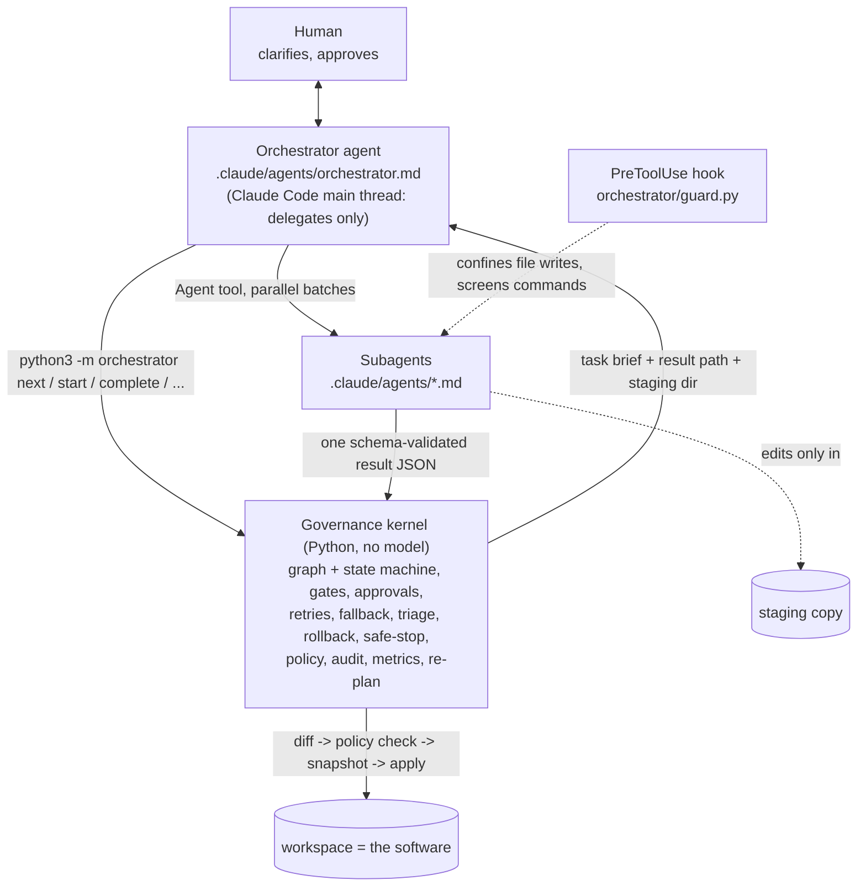
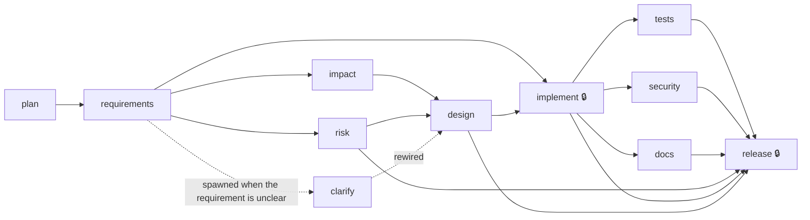

# Architecture

## 1. Two layers, one rule: the model never governs itself

- **Agents decide what to build and how** (subagent files = role, tools, model, instructions).
- **The kernel decides whether it may happen** and keeps the evidence. It is a plain state machine persisted in
  `runs/<name>/state.json`; each CLI call performs one transition and prints JSON. It contains no model calls and
  launches no processes other than the project's own test/setup commands.
- **The orchestrator agent is the glue**: it calls the kernel, delegates, and relays questions to the human. Its tools are
  `Agent, Bash, Read, AskUserQuestion` - no Write/Edit, so it cannot change the project or the evidence itself. Even if it
  misbehaves, the kernel refuses transitions that skip a control (start before approval, before dependencies, with a bad result...).

## 1b. Input and scope handling

A run is `requirement file + project folder (+ optional run config)`. Nothing about the scope is configured by name; the app works it out:

- **New project vs change to existing code**: the kernel looks at the project folder (files not ignored by its own `.gitignore`). Empty ->
  `new-project`: the planner may waive impact analysis and the design agent picks a stack from the requirement text. Not empty ->
  `existing-project`: impact analysis reads the code, design must reuse its stack, risks include regression/migration, the diff must stay minimal.
- **Kind of work**: the requirements agent classifies `change_kind` (`new-build`, `change-existing`, `bug-fix`, `refactor`, `tests-or-docs`);
  for `tests-or-docs` the design states production code is unchanged and the implementer touches tests/docs only.
- **Precise vs unclear requirement**: the requirements agent lists genuine ambiguities, each with a default assumption. If any exist the kernel
  spawns a `clarify` human stage at runtime and rewires `design` after it; unanswered ambiguities fall back to the defaults, recorded as assumptions.
  A later `amend` (e.g. a change request) re-runs only affected stages.
- The optional run config carries `title`, `release_version`, a simulated `reviewer` for `--scripted`, fault `faults` and a scripted `amendment`; it
  never describes the requirement or the scope.

## 2. The workflow (`workflows/sdlc.json`)

Stage fields: `agent` (subagent file), `deps`, `optional`, `high_impact`, `writes`, `max_retries`, `fallback`,
`entry_gate`, `exit_gate`, `kind` (agent | human | kernel), `post` (kernel post-processing). The loader rejects unknown
subagent files, unknown gates, cycles and write-capable stages that do not go through the policy-checked `apply` step.

## 3. A stage, step by step (kernel)

1. `next` lists stages whose dependencies are `DONE`/`WAIVED`; entry gates (`ambiguities_resolved`, `approvals_recorded`) run here.
2. High-impact stages: `approval` writes the facts for an **approval-briefer** subagent; the human decides; `approve` records
   who, when and against which input digests. `start` refuses unless an approval for the *current* inputs exists.
3. `start` renders the **task brief** (`briefs/<stage>.md`: requirement, mode, upstream artifact files, orchestrator
   guidance, commands, working location, output path) and, for write-capable stages, creates an **isolated staging copy** (deleted after the stage succeeds; kept after a failure for debugging)
   (project files per the project's own `.gitignore`).
4. The orchestrator delegates to the subagent. The subagent writes `results/<stage>.json`.
5. `complete` validates the result against `schemas/<stage>.json`, then post-processes **independently of the agent**:
   - `apply`: collect the staging diff -> policy check (paths, size, secrets, dangerous code; all-or-nothing) -> snapshot -> atomic apply.
   - `tests`: the kernel re-runs setup + the design's test command; its exit code is authoritative.
   - `security`: agent findings merged with a data-driven pattern scan of the changed files.
   - `design`: agent-authored commands are screened by policy.
   - `plan`/`requirements`: waive **optional** stages only; spawn `clarify` and rewire `design` when ambiguities exist.
   Then the exit gate (`design_complete`, `files_written`, `tests_green`, `no_high_findings`, `release_go`) runs.
6. Failure handling (bounded): retry (`max_retries`) -> **fallback agent** (docs: smaller model, narrower scope) -> **triage**
   (`failure-triager` advises retry-with-guidance / rollback / escalate; one supervised retry per stage; policy violations are
   never retried or triaged) -> **rollback** (reverse completion order from snapshots; downstream `SKIPPED`) or **safe-stop**
   (`HALTED`, nothing lost, `--resume`).
7. `release` is `kind: kernel`: go/no-go is computed from evidence (independent test run, security, docs present, risk
   validations, intact audit chain, recorded approvals, change footprint) - not asked of a model.

**Dynamic re-planning** (audited): optional-stage waivers by the planner; runtime stage spawn + dependency rewire (cycle-checked);
`amend` creates a new artifact version, dependents whose recorded input digest changed become `STALE` and re-run, an identical
re-run output triggers **early cutoff**, and re-run high-impact stages require approval again.

## 4. Governance

- **Policy** (`policy.json`, data): protected paths, size/count limits, language-neutral rules (credentials, private keys,
  dynamic eval, shell exec, unsafe deserialization, disabled TLS verification, SQL built from strings), and a deny-list for
  agent-authored commands (`sudo`, `curl`, `wget`, `ssh`, `rm -rf /`, escaping the workspace...).
- **Hook guard** (`.claude/settings.json` -> `orchestrator guard`): while a run is active, file tools may write only under the
  run's `results/` and `staging/`; network tools are denied; Bash commands are screened by policy and may not touch
  kernel-owned files; subagents may not call `approve/stop/amend/triage` (best effort, see FINDINGS).
- **Audit**: append-only JSONL, `hash = sha256(record + prev)`; edits/deletions/reordering break `verify-audit`. Actors
  distinguish `agent:*`, `human:<name>`, and `(scripted)` reviewers. **Lineage** ties each decision to input/output digests.
- **Metrics** (from the audit log only): attempt/run success rate, retries, fallbacks, triage decisions, rollbacks, policy
  violations, gate blocks, approvals, re-plans, invalidations, early cutoffs, **MTTR**, **end-to-end latency**, per-stage
  latency, subagent runs, tokens and tool uses (as reported by the subagent runs).

## 5. Key decisions

| # | Decision | Why | Rejected |
|---|---|---|---|
| D1 | Agents are Claude Code subagent files | Real tool-using agents with isolated context, defined as reviewable files | Python making LLM calls / spawning headless `claude` |
| D2 | Governance is a deterministic kernel behind a CLI | Controls hold even if the orchestrating model errs; testable without any LLM | Governance written as prompt instructions |
| D3 | Orchestrator agent has no Write/Edit | It cannot change code or evidence; it can only delegate and call the kernel | A general-purpose main agent |
| D4 | Subagents write result files; the kernel validates | Large outputs never pass through orchestrator context; schema-checked | Relaying JSON in chat |
| D5 | Staging copy + policy-checked apply | Agent output cannot reach the project unchecked; all-or-nothing; rollback | Subagents editing the workspace |
| D6 | Independent test re-run is authoritative | "Green" from an agent is a claim | Trusting agent reports |
| D7 | Stack chosen by the design agent; commands/policy from design and data | No hard-coded technology | Per-language adapters |
| D8 | Release readiness computed, approvals recorded against input digests | Governance is not negotiable | LLM release manager |
| D9 | Workflow, policy, schemas, agents are data/files | Process changes are reviewable diffs | Pipeline in code |

## 6. Risks and where they are validated

| Risk | Control | Test |
|---|---|---|
| Orchestrator skips a control | Kernel refuses (`start` w/o approval, unfinished deps, bad state) | `test_governance_cannot_be_skipped` |
| Agent writes outside scope / leaks a secret | Hook + staging + all-or-nothing policy apply | `test_policy_violations_are_never_retried...`, `test_guard_confines_file_writes...` |
| Agent claims tests pass | Kernel re-run | `test_agent_claiming_green_cannot_override...` |
| Malformed/malicious result | Schema validation -> retry | `test_bad_agent_output_is_rejected_by_schema_and_retried` |
| Persistent failure | Bounded retries, fallback, triage, exact rollback | `test_retries_are_bounded...`, `test_triage_rollback_and_escalate` |
| Unapproved high-impact action | Approval recorded against current inputs | `test_unattended_run_cannot_perform_high_impact_actions` |
| Late change | Digest invalidation, early cutoff, re-approval | `test_clarify_stage_is_spawned...` |
| Log tampering | Hash chain, verified at release | `test_audit_log_detects_tampering` |
| A Python module calls a model | Structural test | `test_python_never_calls_a_model_or_launches_claude` |

## 7. Limitations (honest)

See [`FINDINGS.md`](FINDINGS.md) for what was verified and what was not. Structural limits: the kernel cannot prove a human
gave an approval (it records who the orchestrator reports; the transcript is the evidence); containment is hook + staging + allowlists,
not an OS sandbox; subagent output is non-deterministic; tests run twice by design; single run state in JSON;
rollback covers workspace files; there is no deployment target, so release is a decision.

## 8. Requirement traceability

| Assignment requirement | Where |
|---|---|
| 1 Requirement understanding | `requirements-analyst` (statements, ambiguities, defaults) + `clarify` human stage |
| 2 Task decomposition | `requirements.tasks` (task -> stage, dependencies), rendered in every summary |
| 3 Codebase reasoning | `impact-analyst` reading existing code; stack reuse enforced in `solution-designer` |
| 4 Workflow orchestration | `orchestrator.md` + `kernel.py` + `workflows/sdlc.json`: explicit DAG with gates, parallel batches + joins, lineage, approvals, bounded retry / fallback / triage / rollback / safe-stop, policy + hook guardrails, audit, metrics, dynamic re-plan |
| 5 Engineering output | Whatever the subagents produce in `runs/workspace` (code, tests, docs) plus release notes |
| 6 Validation and risk control | Risk register, exit gates, independent test re-run, security review + scan, rollback drills |
| 7 Controlled autonomy | Least-privilege subagent tools, hook confinement, default-deny approvals, bounded triage, kill switch |
| 8 Final engineering summary | `runs/<name>/FINAL_SUMMARY.md`, generated from run state |
