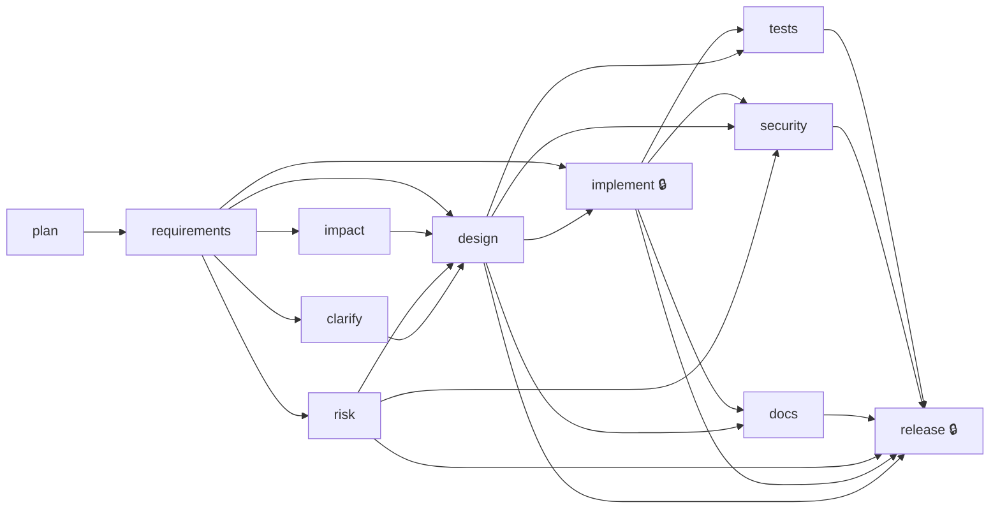

# Final Engineering Summary - URL shortener

**Run status:** SUCCEEDED | **Run:** url-shortener-short | **Release:** v0.1.0 | **Audit chain:** intact (37 records) | **Subagent runs:** 8 (209888, 77)

## 1. Requirement and normalised problem

> # URL shortener
> 
> - Create a short link for a long http(s) URL; return the short code and short URL.
> - Redirect a short link to its original URL; unknown codes return 404.
> - Optional custom alias (3-32 letters, digits, `_` or `-`); a taken alias returns 409.
> - Show a link's click count.
> - Reject invalid URLs with 422.
> - Tech stack: Java with Spring Boot (Maven), JUnit for tests.
> - Provide documented commands to run the service and its tests.

Project: **new-project** | Kind of work: **new-build**. Build a new Java Spring Boot (Maven) service that creates short codes for http(s) URLs, redirects them, supports unique custom aliases, tracks click counts and rejects invalid input, with JUnit tests and documented run/test commands.

| id | type | statement |
|---|---|---|
| S1 | functional | Creating a short link for a long http(s) URL returns the short code and the short URL. |
| S2 | functional | Requesting a short link redirects to its original URL. |
| S3 | functional | Requesting an unknown short code returns 404. |
| S4 | functional | A caller may supply an optional custom alias of 3-32 characters (letters, digits, '_' or '-') which is used as the short code. |
| S5 | functional | Creating a link with an alias that is already taken returns 409. |
| S6 | functional | A link's click count can be retrieved. |
| S7 | functional | Invalid URLs (and invalid aliases) are rejected with 422. |
| S8 | non-functional | The service is implemented in Java with Spring Boot, built with Maven, and tested with JUnit. |
| S9 | non-functional | Documented commands are provided to run the service and to run its tests. |

### Ambiguities found and how they were resolved

| id | terms | question | default assumption |
|---|---|---|---|
| A1 | http(s) URL, invalid URL, long URL | Which schemes are valid, is there a maximum URL length, and must a host be present? | Only http and https with a non-empty host are valid; maximum length 2048 characters; anything else returns 422. |
| A2 | custom alias, taken | Are aliases case sensitive, and may an alias collide with reserved paths (e.g. 'api', 'links')? | Aliases are case sensitive; aliases equal to reserved route names are rejected with 422; generated codes are 7 alphanumeric characters and never collide with existing codes. |
| A3 | click count, click | Does every successful redirect count as one click, and is reading the click count itself a click? | Each successful redirect increments the count by one; unknown codes and stats reads do not; the count is returned by a stats endpoint (GET /api/links/{code}). |
| A4 | redirects | Which redirect status should be used, 301 (cacheable) or 302? | 302 Found with a Location header, so browsers do not cache it and clicks keep being counted. |
| A5 | Invalid URLs, 422 | Should malformed JSON or a missing url field return 422 or 400? | Missing or invalid field values return 422; unparseable JSON bodies return 400. |

Resolved by **human:pavanidurga**:

| ambiguity | source | decision |
|---|---|---|
| A1 | human | Only http/https, max 2048 chars, host required (Recommended) |
| A2 | human | Case-sensitive, reject reserved paths (Recommended) |
| A3 | human | Yes, each redirect increments count by one (Recommended) |
| A4 | human | 302 Found (Recommended) |
| A5 | human | 422 for missing/invalid fields, 400 for unparseable JSON (Recommended) |

## 2. Plan and rationale

### Task decomposition

| task | title | workflow stage | depends on |
|---|---|---|---|
| T1 | Clarify URL validation rules, alias rules, click semantics, redirect status and error codes | clarify | - |
| T2 | Assess risks (alias collisions, concurrency on click counter, open redirect/abuse) | risk | T1 |
| T3 | Design Maven project, REST API, in-memory store and error mapping | design | T1, T2 |
| T4 | Implement create link with URL and alias validation (S1, S4, S5, S7) | implement | T3 |
| T5 | Implement redirect with 404 for unknown codes and click counting (S2, S3, S6) | implement | T4 |
| T6 | Write JUnit tests covering S1-S7 | tests | T4, T5 |
| T7 | Security review of input validation and redirect handling | security | T5, T6 |
| T8 | Document commands to run the service and its tests (S8, S9) | docs | T6 |
| T9 | Prepare release: full test run and release notes | release | T7, T8 |

### Design (stack chosen by the design agent from the requirement: **Java (compiled with java.release=17, runs on the locally installed JDK 25) / Spring Boot 3.5.6 (spring-boot-starter-web, spring-boot-starter-validation, spring-boot-starter-test) / Maven** - Stack is mandated by the requirement (Java, Spring Boot, Maven, JUnit). Boot 3.5.6 parent is already in the local ~/.m2 so build works offline; release 17 is the Boot 3 baseline and compiles on JDK 25. Only three starters to keep supply-chain surface minimal.)

Test command: `mvn -B -q test` | Run: `mvn spring-boot:run`

| id | decision | rationale |
|---|---|---|
| ADR-1 | In-memory ConcurrentHashMap store behind one LinkStore class; no database. | Minimal for the requirement and orchestrator guidance. putIfAbsent gives atomic uniqueness for both aliases and generated codes. Persistence ceiling: all links and clicks are lost on restart and memory is unbounded; a database implementation can replace LinkStore later with its own migration plan. |
| ADR-2 | Redirect with 302 Found and Cache-Control: no-store; redirect route is root-level GET /{code}, API under /api. | Human decision A4. 302 plus no-store keeps clicks counted. Separate /api prefix plus reserved-name rejection means a code can never shadow an API route. |
| ADR-3 | Clicks are AtomicLong in the Link record, incremented only on successful redirect lookup. | Avoids lost updates under concurrent redirects without locks; stats reads never count. |
| ADR-4 | Hand-written URL validation with java.net.URI in LinkService; Bean Validation only for presence/shape of fields, mapped to 422. | No extra libraries; scheme/host/length/control-char rules from clarify A1 are not expressible with @URL alone. Single validation point at create; redirect trusts only stored validated values. |
| ADR-5 | Pin Spring Boot parent 3.5.6 and java.version 17. | 3.5.6 is available in the local Maven cache (offline reproducible); JDK 25 is installed locally and compiles release 17 bytecode. |

Interfaces: `POST /api/links  body {"url": string, "alias": string optional}  -> 201 {"code", "shortUrl", "url"}; 422 invalid/missing url or invalid/reserved alias; 409 alias taken; 400 unparseable JSON`; `GET /{code}  -> 302 Found with single Location header = stored URL, Cache-Control: no-store; increments click count by one; 404 unknown code`; `GET /api/links/{code}  -> 200 {"code", "url", "clicks"}; 404 unknown code; does not change the click count`; `Error body (all errors): {"error": string, "message": string} with no exception class names or stack traces`; `shortUrl = app.base-url + "/" + code (never derived from Host / X-Forwarded-Host)`

| decision | value | source |
|---|---|---|
| A1.url_rules | Only http/https (case-insensitive), non-empty host, max 2048 chars, no whitespace/control chars/CRLF, no userinfo; otherwise 422 | human |
| A2.alias_rules | Regex ^[A-Za-z0-9_-]{3,32}$ full match, case sensitive, reserved names (api, links, actuator, error, h2-console) rejected with 422; taken alias 409 | human |
| A3.click_semantics | Each successful redirect increments by one; unknown codes and stats reads do not; count exposed at GET /api/links/{code} | human |
| A4.redirect_status | 302 Found with Location header and Cache-Control: no-store | human |
| A5.error_codes | 422 for missing/invalid fields, 400 for unparseable JSON | human |
| generated_code_format | 7 chars, SecureRandom over [A-Za-z0-9], shared keyspace with aliases, up to 10 putIfAbsent attempts then 503 without overwriting | design |
| base_url | app.base-url property, default http://localhost:8080 | design |
| stats_endpoint | GET /api/links/{code} | design |
| java_spring_versions | Spring Boot 3.5.6, java.version 17, built on local JDK 25 | design |
| test_command | mvn -B -q test (no install step; deps must already be resolved by setup) | design |

## 3. Orchestration

| stage | state | attempts | agent | seconds | artifact | result |
|---|---|---|---|---|---|---|
| plan | DONE | 1 | workflow-planner | 28.263 | v1 8fcc074a | New project: Spring Boot (Maven) URL shortener with JUnit tests. Waive impact analysis since there is no existing code to analyse; run all o |
| requirements | DONE | 1 | requirements-analyst | 28.939 | v1 ec78105b | New project: Spring Boot (Maven) URL shortener with create, redirect, custom alias, click count and validation, tested with JUnit and docume |
| impact | WAIVED | 0 | - | - | - | - |
| risk | DONE | 1 | risk-analyst | 159.408 | v1 469646b2 | New project: in-memory Spring Boot URL shortener. Main risks are abuse of redirects (unsafe schemes, open redirect, SSRF-style targets), ali |
| clarify | DONE | 1 | human | 162.111 | v1 81b31e5c | 5 decisions, 0 assumed by default |
| design | DONE | 1 | solution-designer | 53.37 | v1 35b28ae0 | New project: single-module Spring Boot 3.5.6 (Maven, Java) URL shortener with an in-memory ConcurrentHashMap store (putIfAbsent for atomic c |
| implement | DONE | 1 | implementer | 312.517 | v1 670ec0b5 | 18 added, 0 modified, 0 deleted (+717/-0 lines); agent: New project: Spring Boot 3.5.6 (Maven, Java 17) URL shortener with in-memory Concurr |
| tests | DONE | 1 | test-engineer | 198.393 | v1 2ff69c5a | 55 passed, 0 failed, 0 errors; independent re-run exit=0 (verified) |
| security | DONE | 1 | security-reviewer | 204.006 | v1 bc482c71 | 2 finding(s), 0 high; New project reviewed. URL validation (http/https only, host required, no userinfo, 2048 cap, no control/non-ASCII/enco |
| docs | DONE | 1 | technical-writer | 204.775 | v1 7d8cebe8 | 1 added, 1 modified, 0 deleted (+124/-13 lines); agent: Rewrote README.md (prerequisites, setup/test/run commands, quick start, API summary, |
| release | DONE | 1 | kernel | 0.001 | v1 cd068f00 | GO v0.1.0: 7/8 checks |

### Decision lineage (who/what decided, from which inputs)

| # | stage | decision | actor | rationale |
|---|---|---|---|---|
| 1 | plan | completed | agent:workflow-planner | New project: Spring Boot (Maven) URL shortener with JUnit tests. Waive impact analysis since there is no existing code to analyse; run all other stages. |
| 2 | impact | waived | agent:workflow-planner | The workspace started empty, so impact analysis has nothing to inspect and adds no value; it is the only optional stage. All mandatory stages remain. Guidance targets the spots where a small service most often goes wrong: validation, status codes, concurrency and toolchain availability. |
| 3 | requirements | completed | agent:requirements-analyst | New project: Spring Boot (Maven) URL shortener with create, redirect, custom alias, click count and validation, tested with JUnit and documented run/test commands. |
| 4 | risk | completed | agent:risk-analyst | New project: in-memory Spring Boot URL shortener. Main risks are abuse of redirects (unsafe schemes, open redirect, SSRF-style targets), alias/code collisions and click-counter races under concurrency, unbounded in-memory growth, and data loss on restart. There is no existing project, so regression and schema migration risk is limited to future changes; the in-memory store has no migration but a later switch to a database would need one. |
| 5 | clarify | completed | agent:human | 5 decisions, 0 assumed by default |
| 6 | design | completed | agent:solution-designer | New project: single-module Spring Boot 3.5.6 (Maven, Java) URL shortener with an in-memory ConcurrentHashMap store (putIfAbsent for atomic code/alias uniqueness, AtomicLong click counter), JSON API under /api, root-level GET /{code} 302 redirect, centralized error mapping (422/400/404/409), JUnit 5 + MockMvc tests. \| stack: Java (compiled with java.release=17, runs on the locally installed JDK 25)/Spring Boot 3.5.6 (spring-boot-starter-web, spring-boot-starter-validation, spring-boot-starter-test) \| test: mvn -B -q test |
| 7 | implement | approved | human:pavanidurga | - |
| 8 | implement | completed | agent:implementer | 18 added, 0 modified, 0 deleted (+717/-0 lines); agent: New project: Spring Boot 3.5.6 (Maven, Java 17) URL shortener with in-memory ConcurrentHashMap store, POST /api/links, GET /{code} 302 redirect with Cache-Control no-store, GET /api/links/{code} stats, centralized 422/400/404/409 error mapping, security headers filter with body size cap, README with run/test commands. |
| 9 | tests | completed | agent:test-engineer | 55 passed, 0 failed, 0 errors; independent re-run exit=0 (verified) |
| 10 | security | completed | agent:security-reviewer | 2 finding(s), 0 high; New project reviewed. URL validation (http/https only, host required, no userinfo, 2048 cap, no control/non-ASCII/encoded CRLF), alias regex with reserved names, atomic putIfAbsent for aliases and codes, AtomicLong clicks, 302 with no-store, configured base URL and generic JSON errors are implemented correctly. Two real gaps remain: the link store has no size cap or rate limit, and the body-size guard is bypassed by chunked requests. |
| 11 | docs | completed | agent:technical-writer | 1 added, 1 modified, 0 deleted (+124/-13 lines); agent: Rewrote README.md (prerequisites, setup/test/run commands, quick start, API summary, configuration, limitations) and added docs/API.md (endpoint reference with examples, error table, data notes), based on the code read in the staging copy. |
| 12 | release | approved | human:pavanidurga | - |
| 13 | release | completed | agent:kernel | GO v0.1.0: 7/8 checks |

### Control events (re-planning, recovery, guardrails)

| seq | event | stage | details |
|---|---|---|---|
| 4 | plan_applied | plan | {'action': 'waive_stage', 'target': 'impact'} |
| 8 | replan | requirements | {'action': 'spawn_stage', 'target': 'clarify'} |
| 9 | replan | requirements | {'action': 'add_dependency', 'deps': ['clarify'], 'target': 'design'} |
| 19 | approval_decision | implement | {'approved': True, 'note': ''} |
| 33 | approval_decision | release | {'approved': True, 'note': ''} |

### Subagent runs

| seq | stage | subagent | tokens | tool uses | ms |
|---|---|---|---|---|---|
| 2 | plan | workflow-planner | 13858 | 3 | 14301 |
| 6 | requirements | requirements-analyst | 14681 | 3 | 17664 |
| 12 | risk | risk-analyst | 17433 | 4 | 30090 |
| 16 | design | solution-designer | 30529 | 9 | 43063 |
| 21 | implement | implementer | 65573 | 29 | 244983 |
| 26 | tests | test-engineer | 14783 | 5 | 19303 |
| 28 | security | security-reviewer | 23500 | 11 | 25217 |
| 30 | docs | technical-writer | 29531 | 13 | 35397 |

## 4. Artifacts

| file | status | +/- |
|---|---|---|
| .gitignore | added | +5/-0 |
| README.md | added | +28/-0 |
| pom.xml | added | +41/-0 |
| src/main/java/com/example/shortener/ApiException.java | added | +22/-0 |
| src/main/java/com/example/shortener/ApiExceptionHandler.java | added | +31/-0 |
| src/main/java/com/example/shortener/CodeGenerator.java | added | +6/-0 |
| src/main/java/com/example/shortener/Link.java | added | +6/-0 |
| src/main/java/com/example/shortener/LinkController.java | added | +46/-0 |
| src/main/java/com/example/shortener/LinkService.java | added | +103/-0 |
| src/main/java/com/example/shortener/LinkStore.java | added | +21/-0 |
| src/main/java/com/example/shortener/RandomCodeGenerator.java | added | +20/-0 |
| src/main/java/com/example/shortener/SecurityHeadersFilter.java | added | +35/-0 |
| src/main/java/com/example/shortener/UrlShortenerApplication.java | added | +11/-0 |
| src/main/resources/application.properties | added | +2/-0 |
| src/test/java/com/example/shortener/ConcurrencyTest.java | added | +83/-0 |
| src/test/java/com/example/shortener/LinkApiTest.java | added | +177/-0 |
| src/test/java/com/example/shortener/LinkServiceTest.java | added | +57/-0 |
| src/test/java/com/example/shortener/LinkStoreTest.java | added | +23/-0 |

- **Tests:** 55 passed, 0 failed, 0 errors; independent re-run exit=0 (verified)
- **Security review:** 2 finding(s), 0 high; New project reviewed. URL validation (http/https only, host required, no userinfo, 2048 cap, no control/non-ASCII/encoded CRLF), alias regex with reserved names, atomic putIfAbsent for aliases and codes, AtomicLong clicks, 302 with no-store, configured base URL and generic JSON errors are implemented correctly. Two real gaps remain: the link store has no size cap or rate limit, and the body-size guard is bypassed by chunked requests.
- **Documentation:** 1 added, 1 modified, 0 deleted (+124/-13 lines); agent: Rewrote README.md (prerequisites, setup/test/run commands, quick start, API summary, configuration, limitations) and added docs/API.md (endpoint reference with examples, error table, data notes), based on the code read in the staging copy.

### Release readiness: **GO**

| check | ok | detail |
|---|---|---|
| tests green (independently re-run) | yes | 55 passed, exit 0 |
| no high-severity security findings | yes | 0 high, 2 medium |
| documentation exists in the workspace | yes | README.md, docs/API.md |
| every risk has a validation plan | yes | 14 risks |
| audit chain intact | yes | ok |
| human approvals recorded for high-impact stages | yes | all present |
| change footprint within policy | yes | 18 files <= 120 |
| assumptions acknowledged | NO | 4 recorded in the summary |

Full notes: `release_notes.md`

## 5. Risks, trade-offs, validation

| id | severity | risk | mitigation | validation planned in design |
|---|---|---|---|---|
| R1 | high | Unsafe URL schemes or hosts accepted (javascript:, data:, file:, missing host, userinfo tricks) | Parse with java.net.URI, allow only http/https (case-insensitive), require non-empty host, cap length at 2048, reject control characters/whitespace and userinfo; return 422. Validate at the create endpoint only, never trust stored values on redirect. | Parameterized MockMvc test in LinkApiTest: javascript:, data:, file:, ftp:, 'http://', 'http://a b', userinfo URL, 2049-char, null/blank url return 422; HTTP://ok.com and valid URLs return 201. |
| R2 | medium | Open redirect and phishing abuse: service redirects to arbitrary attacker URLs | Accept as inherent to a public shortener but document it; use 302 with only the stored Location header, strip CR/LF from the Location value (reject at validation), add X-Content-Type-Options and Referrer-Policy headers, and note rate limiting/blocklist as follow-up before public exposure. | MockMvc: redirect is 302 with single Location equal to stored URL and nosniff/Referrer-Policy headers; URLs with raw CR/LF or %0d%0a rejected 422; security stage checklist; README documents open-redirect caveat. |
| R3 | high | Custom alias collision race: two concurrent creates of the same alias both succeed | Use ConcurrentHashMap.putIfAbsent (or computeIfAbsent) as the single atomic check-and-insert; map a failed insert to 409. Do not use containsKey followed by put. | ConcurrencyTest: 50 threads with CountDownLatch create same alias; assert exactly one 201, 49 409, stored URL is the winner's. |
| R4 | high | Generated code collides with an existing code or custom alias, overwriting a link | Generate 7-char codes with SecureRandom over [A-Za-z0-9] and insert via putIfAbsent in a bounded retry loop (e.g. 10 attempts, then 500/503); generated and custom codes share one keyspace and one atomic insert. | LinkServiceTest with injected CodeGenerator returning a duplicate first then a unique code: existing link untouched, new link gets second code; exhausted retries error without overwrite. |
| R5 | medium | Click counter lost updates under concurrent redirects | Store clicks as AtomicLong (or LongAdder) in the link record and increment only on successful redirect lookup; never read-modify-write on a plain long. | ConcurrencyTest: 100 threads x 10 redirects then GET /api/links/{code} returns exactly 1000; unknown code 404; stats reads leave count unchanged. |
| R6 | medium | Alias collides with reserved routes or is case/format ambiguous, shadowing API endpoints | Enforce regex ^[A-Za-z0-9_-]{3,32}$ using full match (not find), treat aliases as case sensitive, and reject reserved names (api, links, actuator, error, h2-console) with 422. Keep API under /api so a root-level {code} route cannot clash. | Parameterized MockMvc: 'ab', 33 chars, 'a b', 'a/b', 'a.b', unicode, 'abc\n', 'api' give 422; 'abc', 'A_b-9', 32 chars give 201; 'Abc' and 'abc' coexist. |
| R7 | medium | Unbounded in-memory growth enables memory exhaustion (DoS) | Cap URL length at 2048 and request body size (server.tomcat.max-http-form-post-size / spring.codec max in-memory), and document the limit; add a max link count or rate limiting as a follow-up before public exposure. | MockMvc/size-cap test: ~1 MB body rejected with 4xx and nothing stored; URL cap 2048 tested under R1; unbounded map documented as known ceiling in README and limitations. |
| R8 | medium | Data loss on restart: all links and click counts are in memory | State clearly in README that storage is in-memory and ephemeral; hide storage behind one small store class so a database can replace it later. No schema or migration exists in this new project; a future persistence change must add a migration plan. | LinkStoreTest exercises only public methods; README review confirms ephemeral-storage warning. |
| R9 | medium | Wrong status codes and error mapping (400 vs 422, 404 vs 405, 409) break the contract | Add a @RestControllerAdvice mapping MethodArgumentNotValidException and custom validation errors to 422, HttpMessageNotReadableException to 400, unknown code to 404, taken alias to 409; return a JSON error body without stack traces or internal details. | MockMvc: missing url 422, malformed JSON 400, unknown code 404 on redirect and stats, duplicate alias 409; body asserted free of exception class names/stack traces. |
| R10 | low | Redirect cached by browsers (301) causes undercounted clicks | Use 302 Found and set Cache-Control: no-store on redirect responses. | MockMvc: redirect status 302, Location equals original URL, Cache-Control: no-store present. |
| R11 | medium | Short URL built from the Host header allows host-header poisoning in returned shortUrl | Build shortUrl from a configured base-url property (default http://localhost:8080) rather than the incoming Host/X-Forwarded-Host header. | MockMvc: create with spoofed Host: evil.example header; shortUrl starts with configured app.base-url. |
| R12 | medium | Unverified agent-written code: hallucinated APIs, wrong dependency versions, tests that pass vacuously, undocumented commands that do not work | Pin the Spring Boot parent version in pom.xml, use only spring-boot-starter-web, -validation and -test, run the build in a clean checkout, and have the release stage execute the exact documented commands rather than assume them. Review tests for real assertions on every statement S1-S7. | Release stage runs documented setup/test/run commands verbatim from a clean checkout plus curl smoke; traceability check that S1-S7 each have an asserting test; mutation spot check of the 409 and 404 branches; pinned Boot 3.5.6. |
| R13 | low | Dependency and supply-chain exposure from Maven dependencies | Keep the dependency set minimal, rely on the Spring Boot BOM for managed versions, avoid extra libraries for URL validation, and note an OWASP dependency-check or Dependabot step for later. | Review pom.xml has only web, validation, test starters; run mvn dependency:tree to confirm no unexpected artifacts. |
| R14 | low | Privacy: stored long URLs may contain tokens or personal data and are logged | Do not log full target URLs or request bodies at INFO level; no client IP or user data is stored; document that URLs are stored in plain text and exposed through the stats endpoint to anyone knowing the code. | Create and redirect a URL containing a fake token, capture log output and assert the token is absent (no URL/body logging at INFO); README privacy note reviewed. |

Evidence: 55 passed, 0 failed, 0 errors; independent re-run exit=0 (verified)

### Trade-offs

- In-memory store: simplest and race-free via ConcurrentHashMap, but not durable and not shared across instances.
- Hand-rolled validation over a validation library: fewer dependencies, slightly more code to test.
- 302 over 301: every click hits the service (accurate counts) at the cost of no browser/CDN caching.
- Root-level /{code} gives short URLs, requiring reserved-name rejection for aliases.

## 6. Assumptions

- Maven (mvn) and JDK are on PATH, and Boot 3.5.6 artifacts are in ~/.m2 or Maven Central is reachable during setup.
- Service listens on default port 8080 and sits behind no proxy; app.base-url is set per deployment.
- Exhausted code-generation retries return 503 (practically unreachable with 62^7 keyspace).
- The service is not exposed publicly as-is; rate limiting and blocklists are follow-up before public exposure.

## 7. Reliability metrics (from the audit log)

| metric | value |
|---|---|
| attempt_success_rate | 1.0 |
| run_success_rate | 1.0 |
| retries | 0 |
| fallbacks | 0 |
| triage_decisions | 0 |
| rollbacks | 0 |
| policy_violations | 0 |
| gate_blocks | 0 |
| approvals_granted | 2 |
| approvals_denied | 0 |
| replans | 2 |
| stages_invalidated | 0 |
| early_cutoffs | 0 |
| mttr_seconds | None |
| unrecovered_failures | 0 |
| agent_runs | 8 |
| agent_tokens | 209888 |
| agent_tool_uses | 77 |
| e2e_latency_seconds | 968.526 |

## 8. Limitations

- All links and click counts are lost on restart (ephemeral, documented in README).
- No cap on number of links and no rate limiting: memory exhaustion/abuse possible if exposed publicly.
- Open redirect / phishing abuse is inherent to a public shortener; only scheme/host validation is done, no SSRF target or blocklist filtering of private hosts.
- Stored URLs are plain text and readable by anyone who knows the code via the stats endpoint.
- Single instance only; no authentication, no link deletion or expiry.
- Agents are Claude Code subagents: their output is non-deterministic. The orchestrator does not trust it - writes are staged and policy-checked, tests are re-run independently, the release decision is computed from evidence - but design quality still depends on the model.
- Subagents run project commands (setup/test). PreToolUse hooks confine file writes and screen commands, and the diff is policy-checked before apply, but this is not an OS sandbox; run in a container for untrusted requirements.
- The kernel cannot prove that a human gave an approval: it records who the orchestrator says decided (`human:<name>`) and refuses to start a high-impact stage without a recorded approval for the current inputs. Scripted approvals (`--scripted`) simulate reviewers for repeatable demos and are labelled '(scripted)'.
- Single-run JSON state; parallelism comes from the orchestrator delegating independent stages to subagents in one batch.
- Rollback covers workspace files (snapshot restore). There is no deployment target, so release readiness is a go/no-go decision, not a deployment.
- The audit log is tamper-evident (hash chain), not tamper-proof: anchoring the head hash externally is out of scope.
