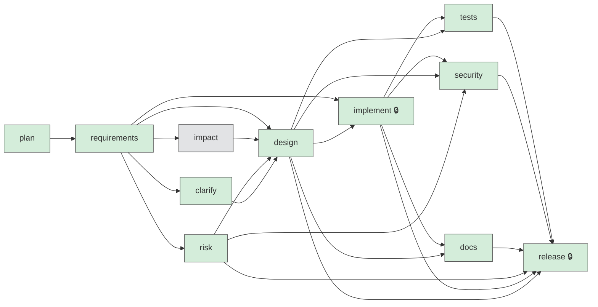

# Workflow - URL shortener

Run: `url-shortener-short` | Project: **new-project** | Status: **SUCCEEDED**

Each box is a stage; arrows mean 'must finish before'. A lock marks a high-impact stage that needs a recorded human approval. Independent stages (no arrow between them) run in parallel. Colour = current state.

States: `DONE` `WAIVED` `RUNNING` `PENDING` `STALE` `FAILED` `ROLLED_BACK` `SKIPPED` `REJECTED` `AWAITING_TRIAGE`

| stage | agent | kind | depends on | entry gate | exit gate | approval | optional | retries | fallback | state |
|---|---|---|---|---|---|---|---|---|---|---|
| plan | workflow-planner | agent | - | - | - | no | no | 1 | - | **DONE** |
| requirements | requirements-analyst | agent | plan | - | - | no | no | 1 | - | **DONE** |
| impact | impact-analyst | agent | requirements | - | - | no | yes | 1 | - | **WAIVED** |
| risk | risk-analyst | agent | requirements | - | - | no | no | 1 | - | **DONE** |
| design | solution-designer | agent | requirements, impact, risk, clarify | ambiguities_resolved | design_complete | no | no | 1 | - | **DONE** |
| implement | implementer | agent | requirements, design | ambiguities_resolved | files_written | yes | no | 1 | - | **DONE** |
| tests | test-engineer | agent | implement, design | - | tests_green | no | no | 1 | - | **DONE** |
| security | security-reviewer | agent | implement, design, risk | - | no_high_findings | no | no | 1 | - | **DONE** |
| docs | technical-writer | agent | implement, design | - | - | no | no | 1 | technical-writer-lite | **DONE** |
| release | kernel | kernel | tests, security, docs, risk, implement, design | approvals_recorded | release_go | yes | no | 0 | - | **DONE** |
| clarify | human | human | requirements | - | - | no | no | 0 | - | **DONE** |

Stages added or waived while the run was in progress (for example `clarify`, or a waived `impact`) appear here as they happen. Full history: `audit.jsonl`; final report: `FINAL_SUMMARY.md`.
